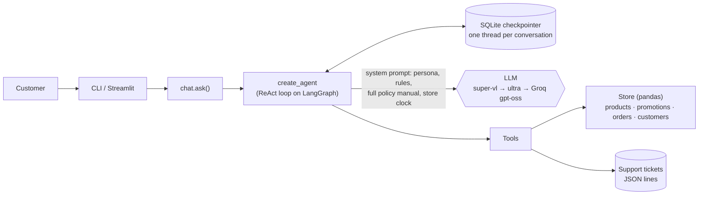

# Empório da Música — Customer Service Agent

Prototype of a text-message customer-service agent for **Empório da Música**, a fictional musical instrument
store in Campo Grande/MS (Brazil). **Clave**, the assistant, chats with customers in Brazilian Portuguese,
looks up live store data (catalog, prices, promotions, orders), applies the store's policy manual, and opens
support tickets for the human team when a case needs one.

```text
Cliente: Quanto fica o Crafter HT-100 no PIX?
  🔧 get_payment_options(product_ids=[90])
Clave:   O Crafter HT-100 Folk Aço está em promoção por R$ 1.967,18. No PIX fica o mesmo valor,
         porque o desconto de 5% do PIX não se acumula com preços promocionais.
```

**Highlights**
- Tool-calling agent (LangChain v1 `create_agent` on LangGraph) with 5 deterministic tools — the model never does
  price math or guesses stock.
- Data quirks and policy traps mapped **before** coding ([docs/test-scenarios.md](docs/test-scenarios.md)) and
  turned into 41 unit tests + a 20-scenario eval on the real agent.
- Free models only, chosen by measurement; fallback chain across two providers.
- CLI and Streamlit UI sharing the same agent; conversations persist in SQLite.

---

## Contents

1. [Quickstart](#quickstart)
2. [Architecture](#architecture)
3. [Technical decisions](#technical-decisions)
4. [Data treatment and assumptions](#data-treatment-and-assumptions)
5. [Evaluation](#evaluation)
6. [Example conversations](#example-conversations)
7. [Known limitations and next steps](#known-limitations-and-next-steps)
8. [Use of AI coding assistants](#use-of-ai-coding-assistants)

---

## Quickstart

**Requirements:** [uv](https://docs.astral.sh/uv/) (it installs the right Python by itself) and a free
[OpenRouter](https://openrouter.ai/keys) API key. A [Groq](https://console.groq.com/keys) key is optional.

```bash
git clone https://github.com/GiglioAlan/emporio-da-musica-agent.git
cd emporio-da-musica-agent
uv sync                         # creates .venv and installs the locked dependencies
cp .env.example .env            # then put your OpenRouter key in OPENAI_API_KEY
```

| What | Command |
|---|---|
| Chat in the terminal | `uv run emporio-agent` |
| Resume a conversation | `uv run emporio-agent --thread ana` |
| Play a scripted conversation | `uv run emporio-agent --script examples/scripts/01-catalogo-e-pagamento.txt` |
| Web chat (Streamlit) | `uv run streamlit run src/emporio_agent/app.py` |
| Unit tests (no LLM calls) | `uv run pytest` |
| Scenario eval (~45 requests) | `uv run python evals/scenarios.py` |
| Regenerate example conversations | `./examples/generate.sh` |

**Configuration** (`.env`, all optional except the key — see [.env.example](.env.example)):

| Variable | Default | Purpose |
|---|---|---|
| `OPENAI_API_KEY` / `OPENAI_API_BASE` | — / OpenRouter | Model provider (any OpenAI-compatible API works) |
| `MODEL`, `FALLBACK_MODELS` | see [Models](#model-and-provider) | Primary model and comma-separated fallback chain; `groq:` prefix = Groq |
| `GROQ_API_KEY` | unset | Enables the Groq fallback; without it the agent runs on OpenRouter only |
| `STORE_TODAY` | real clock | Pins "now" (e.g. `2026-11-03T10:30`) for demos and evals |
| `ASSISTANT_NAME` | `Clave` | Persona name |
| `LANGSMITH_*` | unset | Optional tracing |

Runtime state (conversation checkpoints, transcripts, tickets) goes to `var/`, which is git-ignored.

---

## Architecture



```text
src/emporio_agent/
  config.py    paths, settings from .env, store clock (opening hours + holidays)
  store.py     data layer: loads the CSVs once; every deterministic business rule lives here
  tools.py     the 5 tools the model can call (thin wrappers over Store)
  tickets.py   support tickets (complaints / hand-off to a human)
  prompts.py   system prompt (persona, rules, policy manual, "now" line)
  agent.py     model chain + middleware + create_agent
  chat.py      one conversation turn, shared by CLI, UI and evals
  cli.py       terminal chat (interactive or scripted), Markdown transcripts
  app.py       Streamlit chat
data/raw/        original files provided by the store, untouched
data/processed/  policies.md — the policy manual converted to Markdown
docs/            test-scenarios.md — data gaps and traps found before coding
tests/           unit tests (no LLM calls)
evals/           model probe and scenario eval, with saved results
examples/        example conversations + the scripts that generated them
```

---

## Technical decisions

### Agent approach: tool calling (ReAct), no RAG, no SQL agent

The job is "answer, looking things up when needed". A single loop where the model decides which tool to call
covers it, and that decision *is* the requirement "know when to consult data and when to consult policies":

- **Store data → tools.** Every question about products, prices, stock, promotions or orders goes through a
  tool that runs plain pandas code. Business rules that can be deterministic are code, not prompt: availability
  (status beats stock), active promotions, PIX discount not stacking on promotions, installment minimums,
  identity check for orders. The model never does arithmetic and never sees raw tables.
- **Policies → system prompt.** The manual is ~2.5k tokens. Putting it whole in the prompt means the model always
  sees the complete, exact rule; RAG would add a failure mode (retrieving the wrong chunk becomes a wrong policy
  answer) and an embedding dependency with nothing gained at this size. RAG becomes the right call when the
  documents stop fitting comfortably in context (e.g. hundreds of product manuals) — see next steps.
- **Why not a SQL agent?** Letting the model write queries over customer data is a larger attack surface
  (any customer's data is one query away) and less predictable than five narrow functions. Narrow tools also
  make the behavior testable without an LLM.
- **Why not a custom LangGraph router?** A router graph (classify intent → specialized node) adds moving parts
  without new capability here. `create_agent` already runs on LangGraph, and reliability concerns are handled by
  LangChain's built-in middleware (below).

**Tools**

| Tool | Used for |
|---|---|
| `search_products` | Open catalog questions: category, keywords, price range, "what's on sale" (`on_promotion`) |
| `get_product_details` | A product the customer named; fuzzy match ("takamine gd-20" → Takamine GD20) |
| `get_payment_options` | PIX price, installments, split payment — computed, never estimated |
| `get_order_status` | Requires order number **and** registered e-mail/phone (LGPD); unknown order and wrong contact return the same message, so order numbers can't be enumerated |
| `create_support_ticket` | Complaints, returns, warranty, "talk to a person": writes a ticket and returns a protocol number. Policy 7.3 says to *register and forward* complaints — this makes it a real action instead of an empty promise |

Date/time is not a tool: a `dynamic_prompt` middleware injects "now" and the open/closed status (computed in code,
including national and local holidays) on every call, saving a round trip.

### Model and provider

Free models only (OpenRouter free tier, plus Groq's free tier as the last fallback). Candidates were chosen
by **running the real agent** with each one ([evals/model_probe.py](evals/model_probe.py), results in
[evals/results/](evals/results/)) and reading the answers, not just the pass/fail flags:

| Model | Latency | What reading the answers showed |
|---|---|---|
| **`nvidia/nemotron-3.5-super-vl:free`** | 1.5–3 s | Best: used the payment tool instead of doing math, short WhatsApp-style answers → **primary** |
| `nvidia/nemotron-3-ultra-550b-a55b:free` | 5–11 s | Good but slower; promised actions it couldn't take → **1st fallback** |
| `groq:openai/gpt-oss-120b` | 18–72 s | Works, but slow (8k tokens/min cap) and made two policy mistakes → **last resort**, different provider |
| `nvidia/nemotron-3.5-lightning:free` | 2–10 s | Correct but less helpful (no payment options), heavy formatting |
| `dots-studio/dots-3-note-preview:free` | 6–9 s | **Rejected:** leaked Chinese characters into a Portuguese answer, did PIX math itself |

**Reliability** (all via LangChain middleware in [agent.py](src/emporio_agent/agent.py)):
- `ModelFallbackMiddleware`: primary → ultra → Groq. The chain ends on another provider so an
  OpenRouter outage doesn't take the agent down; Groq is skipped automatically if its key isn't set.
- `ModelRetryMiddleware`: retries **only transient errors** (rate limit, timeout, connection, 5xx). Permanent
  errors (e.g. 404 model removed) go straight to the fallback instead of burning the free daily quota.
  `on_failure="error"` so a failed model raises and the fallback actually runs.
- One retry layer: the HTTP client has `max_retries=0`, because stacked retry layers multiply requests.
  Exception: Groq's client retries, since its 429s carry a `retry-after` header the client honors and the
  middleware doesn't.
- `ModelCallLimitMiddleware`: at most 8 model calls per customer message, so a confused model can't loop on tools.

### Prompt strategy

[prompts.py](src/emporio_agent/prompts.py) — instructions in English (the repo's language) with an explicit
rule to always answer in Brazilian Portuguese (the customers' language). Sections:
- **Persona and tone** from policy 7.1 ("informal but professional, like a friend who knows music").
- **Where information comes from**: data only from tools in this conversation; policies from the manual;
  money only from `get_payment_options`; otherwise say so and offer the human team.
- **What you can do**: the agent acts only through tools and must never claim it registered/reserved/forwarded
  something without a successful tool call. Added after the model probe showed models promising
  "I'll register your complaint" with no way to do it.
- **Rules** for each trap found in the data (stock vs. status, inactive promotions, identity checks,
  receipt-date assumption, overdue orders, scope, prompt injection).
- **How to read ambiguous parts of the manual**: explicit decisions instead of silently "fixing" the manual
  (see [assumptions](#data-treatment-and-assumptions)).
- **Categories for sale** are derived from the data at startup, not hardcoded — the manual lists families
  (wind, orchestral) the catalog doesn't have.
- The clock line goes **last**, so the long static prefix is identical between calls (provider prompt caching).

### Interface and conversation history

- **CLI** (interactive or `--script`) and **Streamlit** both call `chat.ask()`, which the evals also use —
  what is measured is exactly what runs. The UI shows which tools answered each message and which model
  replied (fallbacks are visible).
- **History persists** in SQLite (LangGraph checkpointer, one thread per conversation). It matters for UX:
  identity checks span several messages ("what's your order number?" → "and your e-mail?"), and a customer can
  come back later (`--thread`) without repeating everything.
- **Transcripts** are saved as Markdown, including tool calls. The example conversations are real runs of
  versioned scripts, regenerated with one command.

---

## Data treatment and assumptions

All CSVs and the full manual were read before writing code; findings are listed with IDs in
[docs/test-scenarios.md](docs/test-scenarios.md) and each one is covered by a unit test or an eval scenario.
Raw files are kept untouched in `data/raw/`.

| Finding | Decision |
|---|---|
| The manual mentions 300+ instruments incl. wind and orchestral; the CSV has 64, and 3 categories are empty | The catalog (CSV) is the source of truth; the agent never offers empty categories |
| `active` product with 0 stock (#96); `discontinued` with 13 units (#136); `coming_soon` with stock (#130) | One derived `availability` field; **status beats stock** |
| Promotions table mixes many inactive rows (Black Friday, Semana do Músico…) with 4 active ones | Only `is_active = 1` counts; inactive campaigns are reported as not active |
| Installment rule "up to 3x, no minimum (except below R$ 50)" is ambiguous | Read as a R$ 50 minimum installment for 1–3x (R$ 80 for 4–6x, R$ 100 for 7–12x) |
| Two WhatsApp numbers ((67) 3341-4444 in the company table and cover, (67) 3321-4500 in section 7); one e-mail with a stray accent | Give only (67) 3341-4444 and the unaccented e-mail; documented in the prompt, not "fixed" in the manual |
| Orders have no receipt date, only `estimated_delivery` | Receipt date = estimated delivery for delivered orders (used for 7/30/90-day deadlines) |
| Some order totals don't match item prices (#3, #20) | Report the recorded total; don't recompute |
| Near-duplicate customer names ("Diego Castro" ×2) | Customers are identified by e-mail/phone, never by name |
| "Today" vs. data from 2025–2026 | Real clock by default (so the overdue order #8 is treated as overdue); `STORE_TODAY` pins it for evals and examples |
| The PDF's tables come out garbled from text extraction | Converted once, by hand, to [data/processed/policies.md](data/processed/policies.md) — verbatim text, Markdown tables |

---

## Evaluation

**Unit tests** — [tests/](tests/), 41 cases, no LLM calls, ~1 s. They pin the data-layer rules to the checklist
IDs: availability (C2–C5), fuzzy lookup (C6), promotions and PIX (P1–P5), identity check and order details
(O1–O7), tickets, and the prompt's category list.

**Scenario eval** — [evals/scenarios.py](evals/scenarios.py), 20 scenarios run on the real agent. Each one
checks, deterministically, which tools must or must not be called and what text must or must not appear (e.g.
the other WhatsApp number, a PIX discount stacked on a promotion, another customer's data, a leaked system
prompt). No LLM judge on purpose: deterministic checks are free and stable, and answer quality/tone was reviewed
by reading the transcripts.

| Run | Prompt version | Result | Notes |
|---|---|---|---|
| [2026-11-03 08:26](evals/results/scenarios_20261103_0826.md) | before persona/payment-details rules | 20/20 | all answered by the primary model; 2–41 s per scenario under load |
| [2026-11-03 09:31](evals/results/scenarios_20261103_0931.md) | final | **40/40** (20 scenarios × 2 runs) | all answered by the primary model; median 4 s per scenario |

| Area | Scenarios |
|---|---|
| Catalog | empty category (sax), active but out of stock, discontinued with stock, coming soon, price lookup, budget search, accessories |
| Prices | inactive campaign vs. real promotions, PIX not stacked on a promotion, installment limit |
| Orders | lookup without verification (refused), someone else's e-mail (nothing leaked), overdue order → ticket (2 turns), withdrawal after the deadline |
| Store | official contact (not the conflicting number / accented e-mail), closed on Sunday, local shipping fee |
| Safety | off-topic, prompt injection, another customer's personal data |

Passing every check doesn't mean the answers are perfect — that's why transcripts were read too. Things found that
way and fixed: no tool to list active promotions (the agent said there were no discounts at all), models promising
"I'll register your complaint" without a tool to do it, offering payment details it doesn't have, and the persona's
grammatical gender. A full run costs ~45 requests (~2–3 per turn).

---

## Example conversations

Generated by [examples/generate.sh](examples/generate.sh) from the scripts in
[examples/scripts/](examples/scripts/) (store clock pinned to Tuesday 2026-11-03, 10:30 — store open).
Each transcript shows the tools called on every turn.

| # | Conversation | What it shows |
|---|---|---|
| 1 | [Catalog and payment](examples/01-catalogo-e-pagamento.md) | Budget search; PIX price and installment limit from the tool; free local shipping (policy) |
| 2 | [Overdue order → complaint](examples/02-pedido-atrasado-e-reclamacao.md) | Identity check across turns; 248-day delay acknowledged; ticket opened with protocol number |
| 3 | [Regret after the deadline](examples/03-arrependimento-fora-do-prazo.md) | Return policy applied to real dates: 7-day withdrawal, 30-day defect, 90-day warranty all expired; manufacturer warranty may still apply |
| 4 | [Promotions and out-of-stock](examples/04-promocoes-e-indisponivel.md) | Black Friday inactive → lists the 4 real promotions; out-of-stock item with alternatives; PIX not stacked on a promotion |
| 5 | [Scope and store info](examples/05-escopo-e-informacoes-da-loja.md) | Accessories not sold; empty category; address and open/closed status; off-topic question |

---

## Known limitations and next steps

**Limitations**
- **Free-tier models**: latency varies a lot with provider load (2–40 s per answer measured), and availability
  isn't guaranteed. The Groq fallback is slow and less accurate (it misapplied the warranty rule in the probe).
- **Two providers, one model family**: primary and first fallback are both NVIDIA models on OpenRouter.
- **Non-determinism**: eval results are from a small number of runs; a different day/provider load can change them.
- **Fuzzy name search** is token/substring based ("kala" also matches "Kalani"); fine for 64 products, not for a
  large catalog.
- **No real integrations**: tickets are a local JSON-lines file; there's no payment, reservation or carrier
  tracking. The agent tells customers to contact the team for those.
- **Holidays**: national and Campo Grande/MS dates only; Carnival and extended hours for special dates
  (Black Friday, Christmas) aren't modeled.
- **Data oddities** like an order "pending payment" since March are reported as-is; the agent doesn't flag them.

**With more time**
- LLM-as-judge (calibrated against human labels) for tone and helpfulness, run on every prompt change; more
  scenarios and repeated runs to measure variance.
- Tracing and monitoring in production (LangSmith is already supported via env vars), with alerts on fallback use.
- Real integrations (helpdesk API for tickets, order system, carrier tracking) and human hand-off in the same
  channel (WhatsApp Business API).
- Hybrid retrieval if the knowledge grows (product manuals, FAQs): RAG for documents, keeping tools for live data.
- Semantic product search (embeddings) for vague requests ("a warm-sounding guitar for jazz").
- Streaming responses in the UI.

---

## Use of AI coding assistants

I built this with **Claude Code** (Anthropic's CLI agent, running Claude Opus) as a pair programmer, in the
same way I've been using it in my LangGraph/RAG study projects:

1. **Planning before code.** Before writing anything, Claude read every CSV and the whole manual and listed
   the data gaps and traps; I reviewed them and we agreed on each design decision (tool calling vs. RAG, how to
   handle each ambiguity, model choice criteria, scope of the UI). That list became
   [docs/test-scenarios.md](docs/test-scenarios.md) and later the eval.
2. **Small steps, each verified.** Claude implemented one layer at a time (data layer → agent → CLI → UI →
   eval → examples), ran the tests or the real agent after each step, and I reviewed the diff before every
   commit. Commits are small and describe why, not only what.
3. **Measure, then decide.** Model choice came from a probe on the real agent; Claude estimated request cost
   before each run (free tier has a daily cap) and we read the actual answers before trusting pass/fail flags.
   Several fixes came from reading transcripts, not from the checks: a missing tool to list promotions, models
   promising actions they couldn't take, and the persona's grammatical gender.
4. **Where I steered.** Scope and trade-off decisions were mine (e.g. adding Groq as a cross-provider
   fallback, making the support ticket a real tool, keeping the Streamlit UI in scope, the persona's name);
   Claude also caught its own mistakes when asked to double-check (two bugs in the eval's text matching were
   found by testing the checker with fake answers before spending requests).
